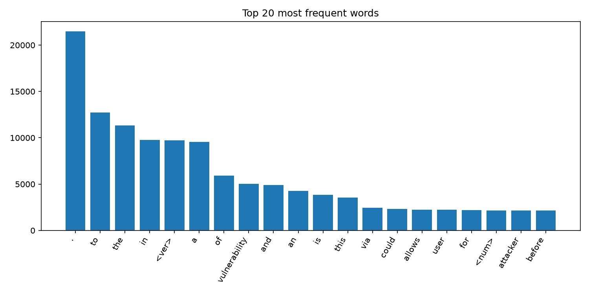

# Cybersecurity Next-Word Prediction using RNN, LSTM and GRU

A deep learning project that predicts the next word in cybersecurity
vulnerability reports, similar to autocomplete for security advisories.

## Problem
Given a sequence of words from a vulnerability description, predict the
most likely next word. The project compares SimpleRNN, LSTM and GRU models.

## Dataset
- Source: NIST National Vulnerability Database (NVD) API
- CVEs published between 2023 and 2024
- English descriptions only, rejected entries removed

## Data Cleaning
- Lowercased all text
- Removed rejected/disputed entries and long "NOTE:" sections
- Replaced CVE IDs, URLs, version numbers, hex values and numbers with
  tokens: `<cve>`, `<url>`, `<ver>`, `<hex>`, `<num>`
- Removed special symbols and duplicate descriptions
- Kept descriptions between 8 and 60 words

## Dataset Statistics
| Metric | Value |
|---|---|
| Descriptions | 10,800 |
| Total words | 344,512 |
| Unique words | 18,991 |

## Preprocessing
- Full stops treated as separate tokens
- 90/10 train/validation split by description (prevents leakage)
- Vocabulary limited to top 5,000 words; others mapped to `<unk>`
- Each description converted to (context → next word) examples
  using up to 20 previous words, front-padded with zeros
- Integer labels used instead of one-hot to save memory

## Project Progress
- [x] Day 1: Data download and cleaning
- [ ] Day 2: Tokenization and sequence creation
- [ ] Day 3: SimpleRNN, LSTM, GRU models
- [ ] Day 4: Training and graphs
- [ ] Day 5: Evaluation, text generation, Streamlit demo